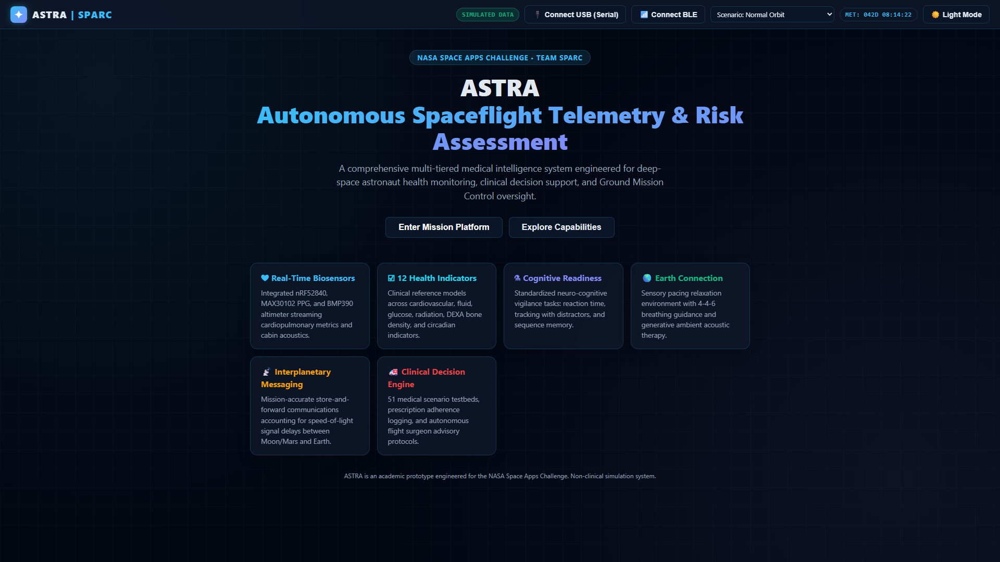
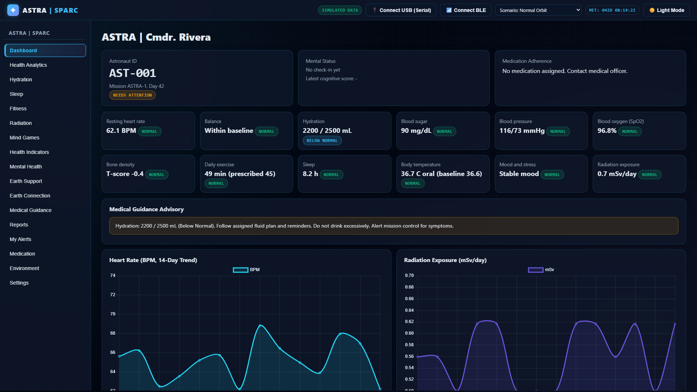
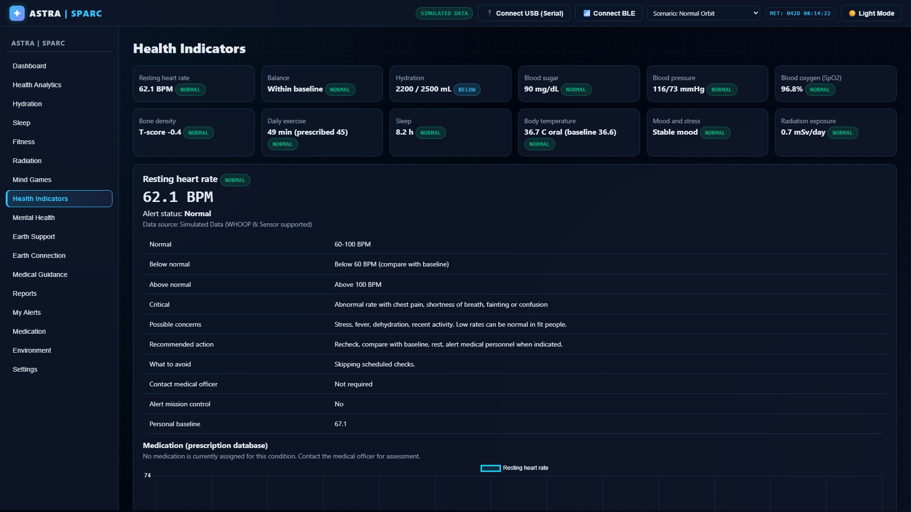
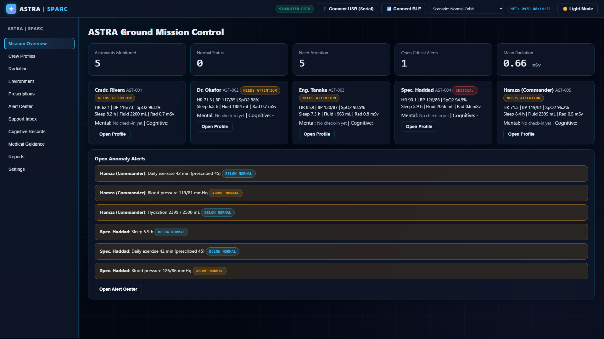
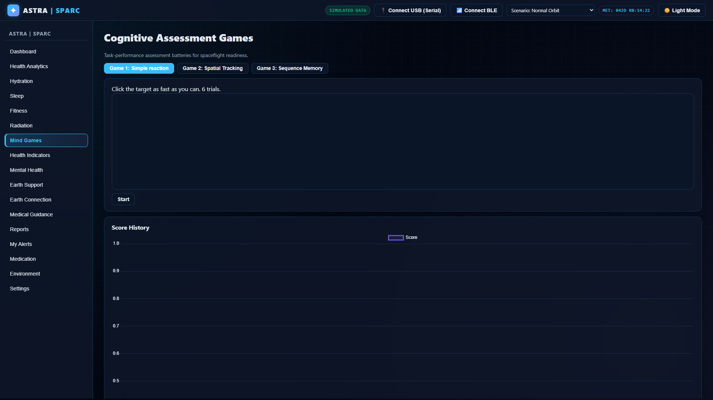
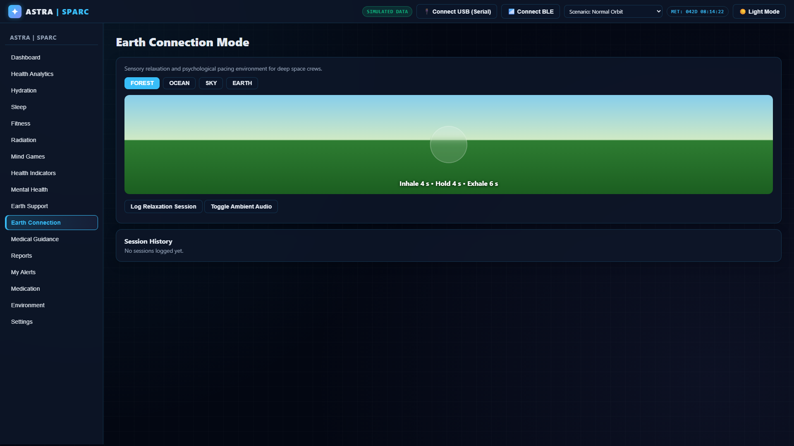

<div align="center">

# 🚀 ASTRA
### Autonomous Spaceflight Telemetry & Risk Assessment

[](https://www.spaceappschallenge.org/)
[](https://github.com/)
[](https://www.python.org/)
[](https://flask.palletsprojects.com/)
[](https://www.nordicsemi.com/)
[](LICENSE)

*A multi-tiered medical intelligence and telemetry platform engineered for deep-space astronaut health monitoring, autonomous clinical decision support, and Ground Mission Control oversight.*

---

[Key Features](#-key-features) • [System Architecture](#-system-architecture) • [Screenshots](#-screenshots--ui-showcase) • [Hardware Setup](#-hardware-setup) • [Quickstart](#-quickstart-guide) • [API Documentation](#-api-endpoints)

---

</div>

## 🌌 Overview

In long-duration deep-space exploration (Artemis lunar sorties, Mars transits), crews operate beyond the safety umbrella of rapid medical evacuation. Communication latency to Earth ranges from **1.3 seconds (Moon)** to **over 20 minutes each way (Mars)**, rendering real-time telemedicine impossible during acute crises.

**ASTRA (by Team SPARC)** unites a custom low-power wearable sensor module (`Nordic nRF52840` + `MAX30102` PPG + `BMP390` barometric altimeter) with an intelligent browser cockpit and ground mission control system. It tracks **12 clinical health indicators**, executes autonomous risk triage, assesses neuro-cognitive readiness, and supports astronaut psychological resilience.

---

## ✨ Key Features

| Capability | Description |
| :--- | :--- |
| 🫀 **Real-Time Wearable Telemetry** | Native streaming over **Web Bluetooth API** (BLE Service `0x180D`, Char `0x2A37`) or **Web Serial API** (USB-C 115200 baud) without external drivers. |
| 📊 **12 Deep-Space Clinical Indicators** | Continuous scoring of cardiovascular, SpO2, blood pressure, core temperature, glucose, DEXA bone density, hydration, exercise countermeasures, circadian sleep, mood, vestibular balance, and radiation. |
| 🚨 **Audible & Visual Anomaly Alarms** | Browser-native **Web Audio API** dual-frequency siren and pulsing alert banner triggering automatically on critical arrhythmias or hypoxia ($<92\%$). |
| 👆 **Sensor Contact & Finger Detection** | Dynamic infrared reflection analysis (`irValue < 50000`) distinguishing detached sensors (`NO FINGER`) from genuine physiological arrest. |
| 🧠 **Cognitive Readiness Testbed** | 3 standardized neuro-cognitive tasks: Psychomotor Vigilance Reaction Time (PVT), Dual-Task Distractor tracking, and Sequence Memory. |
| 🌿 **Earth Connection & Sensory Pacing** | Guided 4-4-6 breathing pacer with generative ambient acoustic therapy to alleviate isolation and autonomic stress. |
| 📡 **Interplanetary Store-and-Forward Comms** | Speed-of-light propagation simulation modeling realistic communication delays between Earth and deep-space crews. |
| 🩺 **51 Clinical Scenarios & Decision Engine** | Interactive medical testbeds (Hypoxia, EVA exertion, fever, cardiac arrhythmias) with flight surgeon advisory protocols. |
| 💾 **Instant Telemetry CSV Export** | One-click export of complete mission medical records (`/api/telemetry/export.csv`) for ground clinical analysis. |

---

## 🏗️ System Architecture

```mermaid
flowchart TD
    subgraph Wearable ["Wearable Hardware Node"]
        MAX["MAX30102 PPG Sensor\n(Heart Rate & SpO2)"] -->|I2C| MCU["Nordic nRF52840 MCU\n(ARM Cortex-M4F @ 64MHz)"]
        BMP["BMP390 Sensor\n(Cabin Pressure & Altimeter)"] -->|I2C| MCU
    end

    subgraph Comm ["Wireless / Serial Transport"]
        MCU -->|BLE 5.0 Notify (UUID 0x2A37)| WB["Web Bluetooth API"]
        MCU -->|USB-C CDC (115200 Baud)| WS["Web Serial API"]
    end

    subgraph Platform ["ASTRA Web Platform (Flask + Vanilla SPA)"]
        WB --> JS["astra_app.js\n(Real-Time Telemetry Parser)"]
        WS --> JS
        JS --> Audio["Web Audio API\n(Critical Siren)"]
        JS --> REST["REST API Engine\n(app.py)"]
        REST --> DB[("SQLite Database\nastrohealth.db")]
    end

    subgraph Views ["Operational Roles"]
        REST --> Astro["Astronaut Cockpit\n(17 Dynamic Views)"]
        REST --> MC["Ground Mission Control\n(11 Flight Surgeon Views)"]
    end
```

---

## 📸 Screenshots & UI Showcase

<div align="center">

### 1. Mission Platform Landing Page


### 2. Astronaut Health Cockpit & 14-Day Vitals


### 3. The 12 Deep-Space Clinical Indicators


### 4. Ground Mission Control & Crew Triage


### 5. Neuro-Cognitive Readiness Assessment


### 6. Earth Connection Sensory Relaxation (4-4-6 Pacer)


</div>

---

## 🛠️ Hardware Setup

### Bill of Materials (BOM)
1. **MCU:** Nordic Semiconductor nRF52840 (Adafruit Feather nRF52840 Express or Seeed XIAO nRF52840 Sense).
2. **Pulse Oximeter:** SparkFun / generic MAX30102 module.
3. **Barometric Altimeter:** Adafruit / Bosch BMP390 module.

### I2C Pin Connections
| Component | Pin | nRF52840 Pin | Function |
| :--- | :--- | :--- | :--- |
| **MAX30102** | `VCC` | `3.3V` | Power supply |
| **MAX30102** | `GND` | `GND` | Ground |
| **MAX30102** | `SDA` | `SDA` (D4 / P0.26) | I2C Data |
| **MAX30102** | `SCL` | `SCL` (D5 / P0.27) | I2C Clock |
| **BMP390** | `VIN` | `3.3V` | Power supply |
| **BMP390** | `GND` | `GND` | Ground |
| **BMP390** | `SDA` | `SDA` (D4 / P0.26) | Shared I2C Data |
| **BMP390** | `SCL` | `SCL` (D5 / P0.27) | Shared I2C Clock |

*Firmware source code and flashing instructions are available in [firmware/AstroHealth_nRF52840/](firmware/AstroHealth_nRF52840/).*

---

## ⚡ Quickstart Guide

### Prerequisites
- **Python 3.10+**
- A modern Chromium-based browser (**Google Chrome**, **Microsoft Edge**, or **Opera**) for Web Serial & Web Bluetooth support.

### 1. Clone the Repository
```bash
git clone https://github.com/<your-username>/ASTRA.git
cd ASTRA
```

### 2. Install Dependencies
```bash
pip install -r requirements.txt
```

### 3. Launch ASTRA
You can simply double-click `run_app.bat` on Windows, or launch via terminal:
```bash
cd web
python app.py
```
Open your browser to: **`http://127.0.0.1:5000`**

### 4. Demo Login Credentials
- **Astronaut Role:** Select any crew member (`Hamza (Commander)`, `Cmdr. Rivera`, etc.) $\rightarrow$ Password: `demo`
- **Mission Control Role:** Select `Earth Mission Control` $\rightarrow$ Password: `demo`

---

## 🔌 API Endpoints

| Method | Endpoint | Description |
| :--- | :--- | :--- |
| `GET` | `/api/telemetry` | Returns the latest biometric telemetry readings. |
| `POST` | `/api/telemetry` | Ingests live telemetry packets from hardware / bridges. |
| `GET` | `/api/telemetry/export.csv` | Streams a complete medical telemetry CSV attachment. |
| `GET` | `/api/crew` | Fetches crew roster and current risk classifications. |
| `GET` | `/api/alerts` | Fetches active and historical clinical alerts. |
| `POST` | `/api/cognitive` | Submits neuro-cognitive test scores and response latencies. |
| `POST` | `/api/simulate/tick` | Advances the physiological simulation by one cycle. |
| `POST` | `/api/simulate/scenario` | Triggers a clinical emergency scenario (`HYPOXIA`, `EVA_EXERTION`, etc.). |

---

## 📁 Repository Structure

```
ASTRA/
├── .github/
│   └── workflows/
│       └── ci.yml               # Automated CI build & syntax testing
├── docs/                        # Engineering guides & medical documentation
│   ├── HARDWARE_WIRING.md       # Pinout schematics & sensor specs
│   └── CLINICAL_INDICATORS.md   # The 12 health indicators & triage rules
├── firmware/                    # Production Arduino C++ firmware
│   └── AstroHealth_nRF52840/
│       ├── AstroHealth_nRF52840.ino
│       └── README.md
├── screenshots/                 # High-resolution platform UI captures
│   ├── 01_ASTRA_Landing_Page.png
│   ├── 02_Astronaut_Dashboard.png
│   ├── 03_12_Health_Indicators.png
│   ├── 04_Health_Analytics_Charts.png
│   ├── 05_Ground_Mission_Control.png
│   ├── 06_Cognitive_Assessment.png
│   ├── 07_Earth_Connection_Relaxation.png
│   └── 08_ECLSS_Environment.png
├── web/                         # Full Flask Application & Telemetry Engine
│   ├── static/
│   │   ├── css/
│   │   │   ├── astra_style.css  # ASTRA design system & theme variables
│   │   │   └── astro_theme.css
│   │   └── js/
│   │       ├── astra_app.js     # Unified SPA router & hardware interface
│   │       ├── cognitive_test.js
│   │       └── telemetry.js
│   ├── templates/
│   │   ├── index.html           # Master application shell
│   │   ├── astronaut.html
│   │   ├── mission_control.html
│   │   └── base.html
│   ├── app.py                   # Flask REST server & simulation engine
│   ├── database.py              # SQLite persistence layer
│   ├── serial_bridge.py         # Standalone COM-port forwarding utility
│   └── run_server.bat
├── .gitattributes               # Line ending normalization rules
├── .gitignore                   # Ignored cache, virtual envs, and binaries
├── LICENSE                      # MIT Open Source License
├── README.md                    # Project documentation & showcase
├── requirements.txt             # Minimal Python dependencies
└── run_app.bat                  # One-click portable Windows runner
```

---

## 👥 Team SPARC

Developed with pride for the **NASA Space Apps Challenge 2026**.

*Disclaimer: ASTRA is an academic proof-of-concept prototype engineered for spaceflight telemetry research and simulation. It is not approved as a diagnostic medical device for terrestrial clinical care.*
