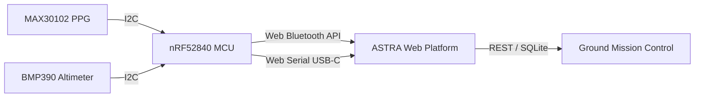

# ASTRA Hardware Architecture & Wiring Documentation

## 🔌 System Schematic Overview

The wearable subsystem is engineered around the **Nordic Semiconductor nRF52840** (ARM Cortex-M4F @ 64 MHz, 1MB Flash, 256KB RAM with native BLE 5.0 and USB 2.0).

```
 +-------------------------------------------------------+
 |                 Nordic nRF52840 MCU                   |
 |                                                       |
 |     3.3V OUT -------+--------------------+            |
 |     GND ------------|--------------+     |            |
 |     SDA (D4) -------|----+         |     |            |
 |     SCL (D5) -------|----|----+    |     |            |
 +---------------------|----|----|----|-----|------------+
                       |    |    |    |     |
                       |    |    |    |     |
              +--------+    |    |    +-----+--------+
              |             |    |          |        |
        +-----+------+      |    |    +-----+------+ |
        |  MAX30102  |      |    |    |   BMP390   | |
        |  (PPG HR)  |      |    |    | (Pressure) | |
        +------------+      |    |    +------------+ |
        | VCC  [3.3V]<------+    |    | VIN  [3.3V]<--+
        | GND  [GND ]<-----------+    | GND  [GND ]<--+
        | SDA  [SDA ]<-----------+--->| SDA  [SDA ]
        | SCL  [SCL ]<----------------| SCL  [SCL ]
        +------------+                +------------+
```

---

## 🔬 Sensor Roles

1. **MAX30102 High-Sensitivity Pulse Oximeter & Heart-Rate Sensor**:
   - Dual Red (660nm) and Infrared (880nm) LEDs with photo-detectors.
   - Measures peripheral capillary oxygen saturation ($\text{SpO}_2$) and photoplethysmography (PPG) pulse waves.
   - Built-in ambient light cancellation and digital filtering.

2. **Bosch BMP390 Precision Barometric Pressure & Altimeter**:
   - Ultra-low noise barometric pressure measurement down to 0.02 Pa RMS.
   - Critical for cabin decompression detection, airlock cycling, and Extravehicular Activity (EVA) suit pressurization monitoring.
   - Integrated high-accuracy temperature sensor for baseline body/cabin monitoring.

---

## 📊 Telemetry Pipeline


